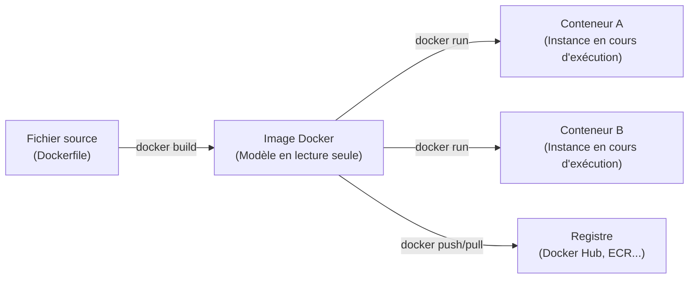
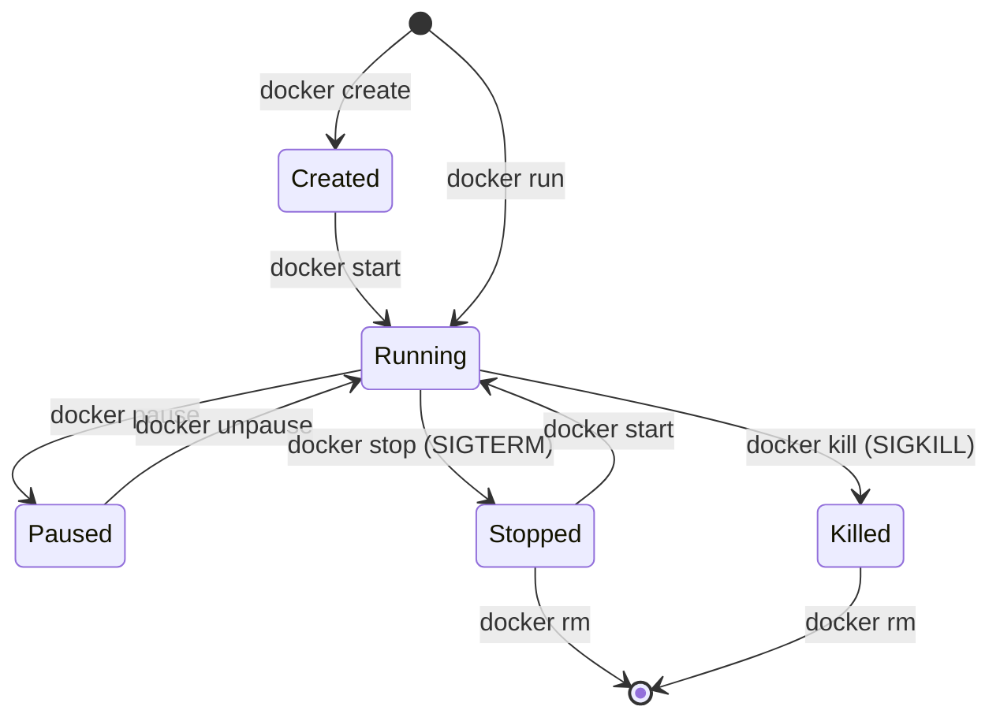

# Recherche approfondie : Images et Conteneurs Docker

Ce document synthétise les concepts fondamentaux, le fonctionnement interne, les différences clés et les commandes indispensables pour maîtriser les **Images** et les **Conteneurs** sous Docker.

---

## 1. Vue d'ensemble et Problématique résolue

Avant Docker, le déploiement d'applications souffrait du problème classique : *"Pourtant, ça fonctionne sur ma machine !"*. 

Les écarts de versions d'OS, de bibliothèques, de dépendances et de configurations système entraînaient des bugs en production. Docker résout ce problème grâce à la **conteneurisation**, qui permet d'empaqueter une application et l'ensemble de son environnement d'exécution de manière portable, légère et reproductible.



---

## 2. L'Image Docker : Le Modèle (Blueprint)

### Définition
Une **image Docker** est une archive immuable (en lecture seule) contenant tout ce qui est nécessaire pour faire tourner une application :
- Un système de fichiers de base (ex. Debian, Ubuntu, Alpine).
- Les dépendances système et binaires (ex. Python, Node.js, OpenSSL).
- Le code source de l'application.
- Les variables d'environnement, métadonnées et la commande de démarrage (`ENTRYPOINT` / `CMD`).

### Architecture en couches (Layered Architecture & UnionFS)
Une image n'est pas un bloc monolithique : c'est un **empilement de couches en lecture seule** (*read-only layers*).
- Chaque instruction du `Dockerfile` (`FROM`, `RUN`, `COPY`, etc.) produit une nouvelle couche.
- Le moteur de stockage (généralement **Overlay2**) superpose ces couches grâce à un système de fichiers unifié (*Union File System*).
- **Mise en cache** : Si une couche n'a pas changé, Docker la réutilise lors des builds suivants, ce qui accélère considérablement le développement et réduit la bande passante lors des téléchargements.

> **Partage de couches** : Si 5 images différentes sont basées sur `alpine:3.19`, cette couche de base n'est stockée qu'une seule fois sur votre disque dur et partagée entre toutes les images.

---

## 3. Le Conteneur Docker : L'Instance Vivante

### Définition
Un **conteneur Docker** est une **instance en cours d'exécution** d'une image. C'est un environnement isolé sur la machine hôte où s'exécute le processus de votre application.

### Comment fonctionne l'isolation ?
Contrairement aux machines virtuelles (VM) qui émulent du matériel complet et démarrent un système d'exploitation invité entier avec son propre noyau (*kernel*), un conteneur **partage le noyau du système hôte**.

L'isolation est assurée par deux briques fondamentales du noyau Linux :
1. **Namespaces (Espaces de nommage)** : isolent la vue de chaque conteneur.
   - `PID` : isolation de l'arbre des processus (le conteneur a son propre PID 1).
   - `NET` : interfaces réseau, ports et tables de routage dédiés.
   - `MNT` : points de montage et systèmes de fichiers isolés.
   - `IPC` : communications inter-processus isolées.
   - `UTS` : nom d'hôte (*hostname*) indépendant.
   - `USER` : mappage des identifiants utilisateurs.
2. **Control Groups (cgroups)** : allouent et limitent les ressources matérielles (CPU, mémoire RAM, I/O disque).

### La couche d'écriture (Copy-on-Write)
Lorsqu'un conteneur est lancé à partir d'une image :
1. Docker prend toutes les couches de l'image (en lecture seule).
2. Il ajoute par-dessus une fine couche accessible en écriture appelée **Container Layer** (ou *Writable Layer*).
3. Toute modification de fichier, création de log ou écriture temporaire est stockée dans cette couche selon le principe du **Copy-on-Write (CoW)**.

> **Éphémérité** : Si le conteneur est supprimé (`docker rm`), sa couche d'écriture est définitivement perdue. Pour conserver des données persistantes (bases de données, fichiers utilisateurs), on utilise des **Volumes Docker** ou des **Bind Mounts**, situés hors du conteneur.

---

## 4. Analogie pour bien comprendre

| Domaine | Équivalent de l'Image | Équivalent du Conteneur |
| :--- | :--- | :--- |
| **Programmation Orientée Objet** | **Classe** (`class Server { ... }`) | **Objet instancié** (`new Server()`) |
| **Cuisine** | **Recette de gâteau** écrite sur une fiche | **Gâteau cuisiné** prêt à être dégusté |
| **BTP / Architecture** | **Plan d'architecte** sur papier | **Maison construite** et habitée |
| **Installation de logiciels** | **Fichier d'installation** (`.iso` / `.exe`) | **Processus actif** dans le gestionnaire des tâches |

---

## 5. Cycle de vie d'un Conteneur

Un conteneur traverse plusieurs états au cours de son existence :



1. **Created** : Le conteneur est alloué avec sa couche d'écriture, mais le processus principal ne tourne pas encore.
2. **Running** : Le processus principal tourne au premier plan.
3. **Paused** : Les processus sont suspendus temporairement via les cgroups freezer.
4. **Stopped / Exited** : Le processus a terminé son exécution ou a été arrêté proprement (`SIGTERM`, puis `SIGKILL` après un délai de grâce).
5. **Deleted** : Le conteneur et sa couche writable sont supprimés.

---

## 6. Tableau comparatif : Image vs Conteneur

| Critère | Image Docker | Conteneur Docker |
| :--- | :--- | :--- |
| **Nature** | Modèle statique, fichier binaire / archive | Processus dynamique en cours d'exécution |
| **Permissions** | **Lecture seule** (*Read-Only*) | **Lecture et Écriture** (*Read-Write Layer*) |
| **Stockage** | Empilement de couches immuables | Couche de modification éphémère + Volumes |
| **Multiplicité** | Une seule image peut engendrer $N$ conteneurs | Chaque conteneur provient d'une image source |
| **Persistance** | Pérenne, versionnée par des tags (`v1.0`, `latest`) | Éphémère par défaut (sauf si volumes associés) |
| **Partage** | Distribuée via des registres (Docker Hub, GitHub CR) | Spécifique à la machine hôte sur laquelle il s'exécute |

---

## 7. Commandes essentielles de manipulation

### A. Gestion des Images

```powershell
# Télécharger une image depuis Docker Hub
docker pull nginx:alpine

# Lister toutes les images présentes localement
docker images
# ou
docker image ls

# Construire une image depuis un Dockerfile du répertoire courant
docker build -t mon-application:1.0 .

# Inspecter les métadonnées et couches d'une image
docker image inspect mon-application:1.0

# Supprimer une image locale
docker rmi mon-application:1.0
```

### B. Gestion des Conteneurs

```powershell
# Créer et démarrer un conteneur en arrière-plan (-d) avec mappage de port (-p)
docker run -d -p 8080:80 --name mon-serveur-web nginx:alpine

# Lister les conteneurs actifs
docker ps

# Lister tous les conteneurs (actifs et arrêtés)
docker ps -a

# Exécuter une commande interactive dans un conteneur en cours d'exécution
docker exec -it mon-serveur-web sh

# Consulter les logs émis par le conteneur
docker logs -f mon-serveur-web

# Arrêter un conteneur
docker stop mon-serveur-web

# Redémarrer un conteneur arrêté
docker start mon-serveur-web

# Supprimer un conteneur arrêté
docker rm mon-serveur-web

# Forcer la suppression d'un conteneur en cours d'exécution
docker rm -f mon-serveur-web
```

---

## 8. Bonnes pratiques à retenir

1. **Images légères** : Privilégier les images de base minimales comme `alpine` ou les images `distroless` pour réduire la taille et la surface d'attaque.
2. **Multi-stage builds** : Séparer la phase de compilation (avec outils lourds) de la phase d'exécution finale pour obtenir des images de quelques dizaines de mégaoctets seulement.
3. **Un conteneur = une seule responsabilité** : Éviter de faire tourner un serveur web + une base de données dans le même conteneur. Privilégier `docker-compose` pour orchestrer plusieurs conteneurs interconnectés.
4. **Données hors du conteneur** : Ne jamais stocker de données critiques dans la couche d'écriture du conteneur ; toujours utiliser des **Volumes Docker** (`-v volume_name:/path/in/container`).
